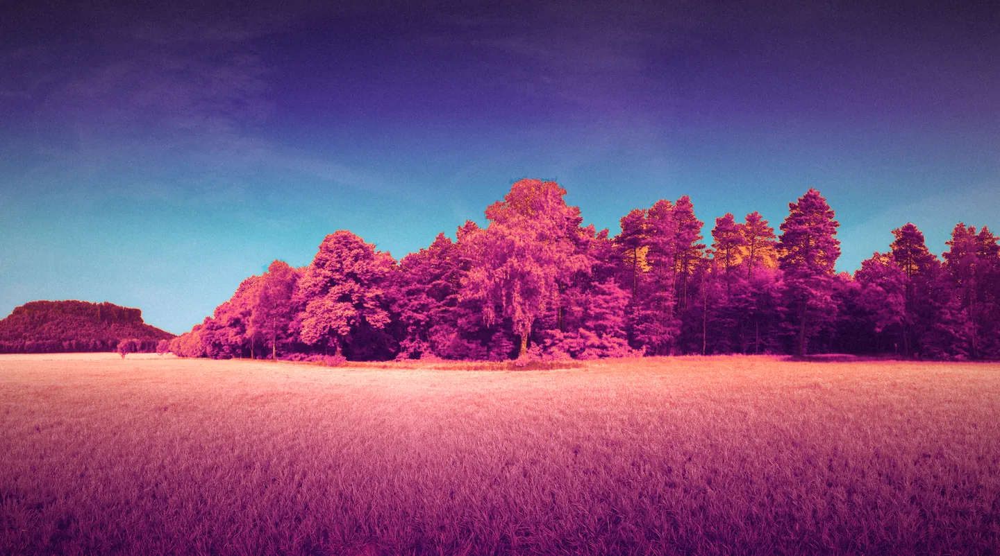
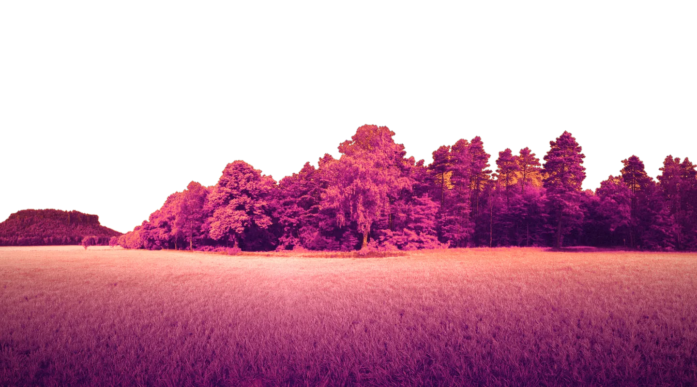

# Infrared Fable — Albretsen AS asset kit (design 36)

Open `preview.html` first (serve the repo root, e.g. `python3 -m http.server`, then `/designs/36/assets/preview.html`). Add `?scene=pinewood` for the second hero, `?still` to freeze motion for screenshots.

## Vision

A real landscape photographed in light you can't see, with a storybook living inside it.

The hero is a full-bleed **false-colour infrared photograph**: a meadow and a treeline regraded the way Kodak Aerochrome rendered the world, with foliage glowing magenta, the sky dropping from violet to a strip of horizon cyan, and warm halation on the highlights. The type is **set into the scene**: each photograph ships with a *front* layer (the same image with the sky cut away), so the name `Albretsen` stands *behind* the trees and rises out of them on load ("Horizon Rise"). In the second scene, misty pines, the type is woven between the trunks.

Living in that photograph are **hand-coloured 19th-century natural-history plates**: butterflies from *The Book of Butterflies, Sphinxes and Moths* (1832–34), a nature-printed fern, and Grandville's *Un autre monde* (1844). They are cut out and re-inked into the infrared palette so engraving and photograph share one light. The result is warm and storybook-like, with maximalist energy, while the technology (numbers, commands, product facts) stays crisp in a monospace.

The brand idea is **aperture → horizon**. The mark is a pointed-arch window looking out at an infrared treeline at sunset. The road running to the horizon forms the counter of an **A**, and the horizon line is its crossbar. The arch recurs everywhere: the product plates, the scroll transition ("Aperture") and the retired-product stand-ins. The spark word **tension** shows up in the deck physics (cards lag and tilt against the pointer) and in the magnetic buttons.

What it is not: no gears, rails, ships, charts or finance-firm sobriety. It never says "hire me".

### Mood words
infrared · storybook · specimen · horizon · aperture · ember · night-violet · hand-coloured · maximal

### References (researched)
- Kodak Aerochrome / false-colour IR look: dye-layer explanation and how foliage reads magenta — https://www.diyphotography.net/?p=115948, https://kolarivision.com/the-irchrome-infrared-photography-filter-our-digital-version-of-kodak-aerochrome/, https://photofocus.com/found/otherworldly-snaps-taken-with-kodak-aerochrome-film/
- Text-behind-subject depth layering (three-layer stack: plate → word → cut-out) — https://www.sliderrevolution.com/tutorials/place-text-behind-objects/, https://rauno.me/craft/depth
- Motion examples: "Card stack", "Drag with spring follow", "Cursor: Magnetic target" — https://motion.dev/examples
- Magnetic buttons (Codrops, Manoela Ilic, 2020): the label moving further than the shell — https://tympanus.net/codrops/2020/08/05/magnetic-buttons
- SVG/clip-path mask transitions on scroll with ScrollTrigger (scrub 2–2.5 for a trailing feel) — https://tympanus.net/codrops/2026/03/11/svg-mask-transitions-on-scroll-with-gsap-and-scrolltrigger/
- Clip-path + scrub pitfalls (keep percentage units) — https://greensock.com/forums/topic/30370-clip-path-scrolltrigger-scrub/
- CSS 3D butterfly: wings hinged at the body with rotateY — https://www.michaelbromley.co.uk/blog/css-javascript-3d-butterfly-a-case-study/
- Studio references for layered, image-led maximalism: https://activetheory.net, https://www.framer.com/gallery, https://godly.website
- Public-domain plates: Biodiversity Heritage Library (via Wikimedia Commons) — https://www.biodiversitylibrary.org

## Palette (OKLCH first)

| Name | OKLCH | Hex | Use |
|---|---|---|---|
| Night | oklch(18.8% 0.081 294) | `#170733` | page ground, ink on cream |
| Dusk | oklch(36.6% 0.171 296) | `#4a1a8c` | upper sky, panels |
| Plum | oklch(38.4% 0.163 325) | `#6b1272` | deep foliage, shadows |
| Aerochrome magenta | oklch(61.7% 0.229 0) | `#e8287f` | primary action, accents, the "AS" tab |
| Ember | oklch(72.6% 0.178 43) | `#ff7a3d` | the sun, the "building" status |
| Peach | oklch(82.5% 0.125 63) | `#ffb36b` | highlights, small labels on night |
| Horizon cyan (seed 192°) | oklch(72% 0.12 192) | `#1abcb8` | the single cool note, used once per view |
| Mist | oklch(89.9% 0.079 190) | `#9fefe9` | horizon glow |
| Plate cream | oklch(96.5% 0.025 69) | `#fff1e2` | paper, type on night |

Signature gradient (left to right): Night → Dusk → Plum → Magenta → Ember → Peach → Cream. The photographs' sky cyan drifts a little toward 205–210° in the image grade. That is intentional and reads as distance.

## Typefaces (Google Fonts, OFL)
- **Gloock** 400: display and storybook voice. Wordmark outlines are converted from this face.
- **Bricolage Grotesque** (variable, opsz 12–96, wght 300–800): text.
- **Martian Mono** (wdth 87.5, wght 300–700): numbers, labels, commands, status chips.

```html
<link href="https://fonts.googleapis.com/css2?family=Gloock&family=Bricolage+Grotesque:opsz,wght@12..96,300..800&family=Martian+Mono:wdth,wght@87.5,300..700&display=swap" rel="stylesheet">
```

## How to build the hero
```html
<header class="hero" data-m-scene>
  <picture class="layer" data-depth=".25">            <!-- back plate -->
    <source type="image/avif" srcset="hero/horizon-1440.avif 1440w, hero/horizon-2880.avif 2880w" sizes="100vw">
    
  </picture>
  <h1 class="word" data-m="rise" data-depth=".55">Albretsen</h1>   <!-- sits between -->
  <picture class="layer front" data-depth=".8">       <!-- same photo, sky removed -->
    <source type="image/avif" srcset="hero/horizon-front-2880.avif 2880w" sizes="100vw">
    
  </picture>
</header>
```
Both plates must use identical `object-fit: cover; object-position: 50% 60%` so the matte lines up at every viewport. Horizon: put the word's baseline at about `bottom: 44%`. Pinewood: about `bottom: 34%` (the word then sits between the trunks).

## Inventory

All paths are relative to `designs/36/assets/`. Total size is about 4.2 MB.

| File | What it is | Intended use | Source | Licence |
|---|---|---|---|---|
| identity/mark.svg | Pointed-arch aperture mark: an infrared treeline, a sun, and a road forming the A | logo, nav, footer, favicon base | Original vector (this kit, generated in Python) | Albretsen AS |
| identity/wordmark.svg | "Albretsen" in Gloock outlines + magenta "AS" tab (Martian Mono outlines), `fill=currentColor` | headers on cream | Outlined from Gloock / Martian Mono via fontTools | Fonts OFL 1.1, outlines OK for logos |
| identity/wordmark-light.svg | Same, cream ink | on night or photo | as above | as above |
| identity/lockup.svg / lockup-light.svg | Mark + wordmark lockup (dark ink / cream ink) | nav, footer, email signature | as above | as above |
| identity/favicon.svg | Mark with a tighter viewBox | `<link rel=icon>` | as above | Albretsen AS |
| identity/favicon-180.png | 180 px apple-touch icon on cream | apple-touch-icon | rsvg-convert of favicon.svg | Albretsen AS |
| identity/og.jpg | 1200×630 Open Graph card: the type set behind the treeline, a butterfly, the line and the URL | og:image / twitter:image | Rendered from `src/og.html` in headless Chrome | Albretsen AS + CC0 / PD sources below |
| hero/horizon-1440.webp, -1440.avif, -2880.avif | Infrared meadow and treeline plate (Aerochrome-style grade, halation, film grain) | hero back layer (default scene) | Poly Haven HDRI "Lilienstein" tonemapped JPG, cropped from the equirectangular panorama and regraded (`numpy` gradient maps, vegetation index, sky matte) — https://polyhaven.com/a/lilienstein | CC0 |
| hero/horizon-front-1440.webp, -front-2880.avif | Same plate with the sky cut away (alpha) | hero front layer: type goes behind the trees | Derived from the above (automatic sky segmentation) | CC0 |
| hero/pinewood-1440.webp, -1440.avif, -2880.avif | Infrared misty pine forest | alternative hero, night or "about" section, product backgrounds | Poly Haven HDRI "Misty Pines", cropped and regraded — https://polyhaven.com/a/misty_pines | CC0 |
| hero/pinewood-front-1440.webp, -front-2880.avif | Thick trunks + ground matte (alpha) | type woven between the trunks | Derived (local-contrast + vertical morphology matte) | CC0 |
| products/plate-mcp-emails.webp | Plate I: the real MCP Emails mark pinned in the arch over the horizon plate, with figure and facts | product card, deck face | Rendered from `src/plate.html?p=mcp-emails`; logo from `_shared/products/mcp-emails/logo-mark.svg` (unaltered) | Product logo © Albretsen AS |
| products/plate-fun-libs.webp | Plate II: the real Fun Libs v5 icon in the pinewood | product card, deck face | as above, `fun-libs/icon.png` | © Albretsen AS |
| products/plate-toolrails.webp | Plate III: the real Toolrails icon in Grandville's comet night | product card, deck face | as above, `toolrails/icon.svg` | © Albretsen AS |
| products/plate-harbor.webp | Plate IV: the real Harbor mark over the marbled endpaper | product card, deck face | as above, `harbor/harbor-mark-filled.svg` | © Albretsen AS |
| products/retired/*.svg | Six arch-window stand-ins: polyglot-pilot (speech bubbles), pinpoint (pin on horizon), webvakt (watching eye), joke-central (grin), tryggere-hyring (shield and check), early-apps (%) | "retired" shelf; Luma uses its real monogram from `_shared` | Original vectors (this kit) | Albretsen AS |
| illustrations/butterfly-black-and-gold.webp | Cut-out *Papilio helena* re-inked violet and ember (alpha) | hero (wingbeat), plate I, OG, scattered | *The Book of Butterflies, Sphinxes and Moths*, Plate XXXVII, BHL 21521220 — https://commons.wikimedia.org/wiki/File:The_book_of_butterflies,_sphinxes_and_moths_(Plate_XXXVII)_BHL21521220.jpg | Public domain |
| illustrations/butterfly-helius.webp | Cut-out Helius butterfly, plum and magenta | plate III, small accents | same book, Plate LII, BHL 21521278 — https://commons.wikimedia.org/wiki/File:The_book_of_butterflies,_sphinxes_and_moths_(Plate_LII)_BHL21521278.jpg | Public domain |
| illustrations/butterfly-brimstone.webp | Cut-out Brimstone, ember and peach | hero second butterfly, plate II | same book, Plate XXVII, BHL 21521187 — https://commons.wikimedia.org/wiki/File:The_book_of_butterflies,_sphinxes_and_moths_(Plate_XXVII)_BHL21521187.jpg | Public domain |
| illustrations/sticker-fern-magenta.webp / sticker-fern-cyan.webp | Nature-printed fern as die-cut stickers (cream border) in two inks | margins, section corners, "about" | *The Ferns of Great Britain and Ireland*, Plate V, BHL 301713 — https://commons.wikimedia.org/wiki/File:The_ferns_of_Great_Britain_and_Ireland_(Plate_V)_BHL301713.jpg | Public domain |
| illustrations/comet-procession.webp | Grandville's "Pérégrinations d'une comète" regraded to night violet, magenta and ember (caption cropped) | night sections, the Toolrails plate, the Aperture scroll reveal | J. J. Grandville, *Un autre monde* (1844) — https://commons.wikimedia.org/wiki/File:Un_autre_monde_P%C3%A9r%C3%A9grinations_d%27une_com%C3%A8te.jpg | Public domain |
| textures/endpaper-marble.webp | Marbled endpaper regraded to the infrared ramp | section breaks, Harbor plate, deck backdrop, footer | Endpaper of *Thoughts upon Hare and Fox Hunting*, BHL 23750303 — https://commons.wikimedia.org/wiki/File:Thoughts_upon_hare_and_fox_hunting_BHL23750303.jpg | Public domain |
| textures/paper-grain.webp | 1024 px neutral paper tile (use `mix-blend-mode: multiply`, opacity about .5) | cream sections, plates | ambientCG Paper004 (colour map, desaturated and normalised) — https://ambientcg.com/view?id=Paper004 | CC0 |
| textures/film-grain.webp | 256 px generated noise tile (overlay, opacity about .12, stepped jitter) | whole-page film grain | Generated (numpy, seed 0xadcf83) | Albretsen AS |
| interactive/specimen-deck.js | Dependency-free DOM card stack with spring physics: drag, fling, flip, keyboard | product section centrepiece | Original code (this kit) | Albretsen AS |
| interactive/deck-demo.html | Standalone demo of the deck | builder reference | Original | Albretsen AS |
| motion.css / motion.js | Motion study: Horizon Rise, Wingbeat, Aperture, Magnetic, Ink Thread, Ember Drift | the whole site | Original; GSAP 3.12.5 + ScrollTrigger via jsDelivr (GSAP standard licence, free) | Albretsen AS |
| src/plate.html, src/og.html | Source pages the plates and OG card were baked from | re-bake if facts change | Original | Albretsen AS |
| src/phone-frame.html | QA helper that renders preview.html in a true 390 px viewport | screenshots | Original | Albretsen AS |
| preview.html | Contact sheet | look here first | Original | Albretsen AS |

## Motion signatures (motion.css + motion.js)

| Name | Kind | What it does | Hook |
|---|---|---|---|
| **Horizon Rise** | entrance | Headline chars rise from *behind* the treeline (the front matte occludes them), blur to sharp, centre-out stagger, `expo.out` 1.6 s. Then the depth layers parallax on scroll (`data-depth`). | `data-m="rise"` inside `[data-m-scene]` |
| **Wingbeat** | idle and hover | A butterfly image is split into two halves hinged at the body and flapped with `rotateY` in 3D. Idle beats come at random intervals; hover makes it flutter fast. Optional scroll drift. | `<span class="m-wing" data-m="wing"></span>` |
| **Aperture** | transition | A section is revealed through an arch-shaped `clip-path` (inset with a 50 vw top radius) that opens to full bleed, scrubbed with `scrub: 2`. The inner image scales from 1.25 to 1. | `.m-aperture[data-m="aperture"]` |
| **Magnetic** | hover (signature delight) | Buttons and links lean toward the pointer within a 90 px field using `gsap.quickTo`. The label moves about 45% further than the shell. On release they snap back on `elastic.out(1,.32)`. Off on touch devices. | `.m-magnetic[data-m="magnetic"]` |
| **Ink Thread** | hover | A magenta SVG wave underline grows in and then runs sideways. | `a.m-ink` |
| **Ember Drift** | ambient | A six-second breathing drop-shadow glow for the mark and the sun. | `.m-ember` |

All six respect `prefers-reduced-motion`.

## Notes for the builder
- Never recolour the product logos. The plates already frame them correctly. If facts change, re-bake from `src/plate.html` (it reads `_shared/content.js`).
- Use horizon cyan sparingly. Magenta is the action colour.
- Butterflies are the "life": three to five per page at most, never over body text.
- The front plates are about 150–320 KB. Load `horizon-front` with the hero and lazy-load `pinewood`.
