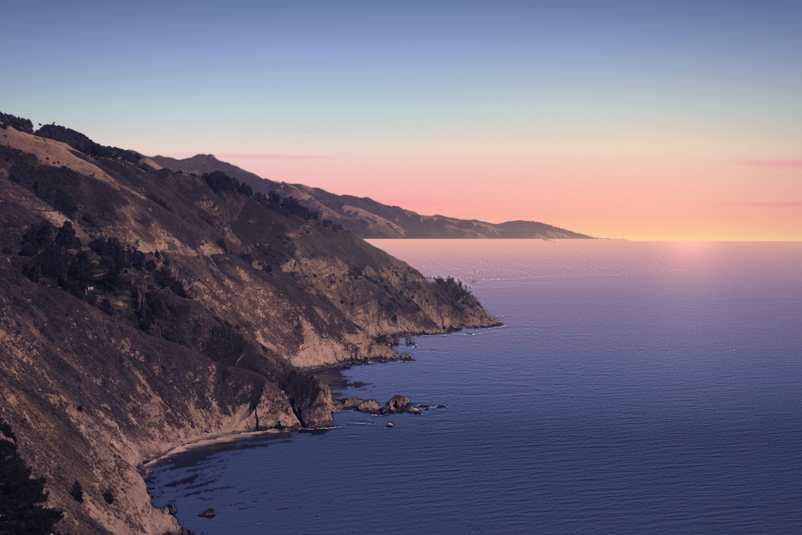

# Asset kit 69: Afterglow

**Brief (taste-weighted):** sunsets and sunrises × Miami deco, afterglow light, Portra/Ektar film, a slow descent over cliffs into a small town, Scandinavian geometric sans in light weights, cross-dissolves, effortless elegance, a hidden easter egg.

Open `preview.html` from a static server rooted at the repo (it reads real logos from `designs/_shared/products/`).

## Vision

The site is one evening, seen in three frames. First the **cliffs**, just after the sun has gone below the sea, with the sky still flamingo and apricot along the horizon. Then the **town**: two pastel deco towers holding the last light against a sky that turns from sky blue through a faint mint band into pink. Then the **shore**, where the sun touches the water. The hero cross-dissolves between them. The dissolve itself is the signature: the darks of the outgoing photograph leave first and its highlights linger, the way a sky keeps burning after sunset.

The products live in that town as glazed tiles mounted on pastel stucco walls, lit by the same low sun, with long soft shadows. The light is the theme and the photographs are real. There is no costume: no palm emoji, no place names in the copy, no hotel signage. That signage was retouched out of the photographs.

**Mood words:** afterglow, unhurried, sun-bleached, exact, quietly expensive, warm, clean light.

**What to avoid when building:** more than one idea per screen; dark mode by default (this is a light, warm site that *ends* at dusk); hard cuts between photographs; type heavier than 400; travel-magazine framing ("discover", "escape").

**The hidden delight (green flash):** in nature, the very last colour the atmosphere lets through after the sun sets is a brief green flash on the horizon, lasting one to two seconds. Rest the pointer on the horizon line of the hero for two seconds, or type `flash`, and a thin mint line blooms there for 1.4 s. Nothing on the page announces it. (The mint in the palette is that flash.)

### Reference URLs
- https://www.godly.website (could not be fetched: DNS failure). Known for line-mask headline reveals, which became *Horizon rise*.
- https://www.cosmos.so: calm single-column pages, image-first grids, one idea per section.
- https://www.slimaarons.com and https://www.hoteldelavillevenice.com (both failed DNS). Used from memory for the light: Slim Aarons' pastel, sun-washed leisure photographs (the long afternoon light and white plaster), and the slow photographic cross-fades of luxury hospitality sites (2.4 to 3 s). The kit keeps their *light* and drops their subject matter.
- Framer "Aperture" scroll-crossfade gallery (framer.com/marketplace/components/aperture-gallery): crossfade + grain + vignette treatment.
- CSS scroll-driven animations: MDN `animation-timeline: view()`, https://developer.mozilla.org/docs/Web/CSS/animation-timeline/view; Josh Comeau, https://joshwcomeau.com/animation/scroll-driven-animations
- Portra emulation technique (lifted blacks, soft shoulder, warm highlights, cool shadows, muted greens): https://mastinlabs.com/blogs/photoism/blog-portra-400-lightroom-authentic-look, https://pixls.us/articles/color-curves-matching/
- Green flash: Hong Kong Observatory, https://www.hko.gov.hk/en/education/earth-science/optical-phenomena/00743-Green-Flash.html
- Salt 3565d6: used as the RNG seed for the stratus clouds, grain and window choices, and to pick results 3, 5 and 6 in the Commons search lists. Those picks became the pink facade candidate, the towers, and the Big Sur frames.

## Palette (Miami deco at afterglow)

| Token | Hex | OKLCH | Use |
|---|---|---|---|
| `--ink` Dusk ink | `#2A2D4F` | oklch(0.312 0.061 278.4) | text, the mark's lines |
| `--plaster` | `#FBF8F4` | oklch(0.980 0.006 75.4) | page background |
| `--flamingo` | `#EE8AA0` | oklch(0.746 0.124 6.4) | accent, the sun in the mark, "AS" |
| `--flamingo-pale` | `#F3BAC4` | oklch(0.843 0.067 6.9) | fills, MCP Emails wall |
| `--mint` | `#8FD3BF` | oklch(0.816 0.075 174.0) | reflection lines, links/focus |
| `--mint-pale` | `#CDEFE3` | oklch(0.924 0.039 172.1) | fills |
| `--sky` | `#9EC3E6` | oklch(0.802 0.064 247.2) | upper sky, quiet fills |
| `--glow` | `#FFC9A0` | oklch(0.874 0.082 58.6) | horizon, highlights on dark |
| `--lilac` | `#7D88C8` | oklch(0.644 0.097 275.9) | shadow tone |
| `--ink-soft` | `#5A5E80` | oklch(0.492 0.055 279.0) | secondary text (AA on plaster) |
| `--flash` | `#8CFFD1` | oklch(0.919 0.124 165.8) | green flash only |

Sky-turn gradient stops (motion.css): start `#DCE8F4 → #F4F1EC → #FBF8F4`, end `#AEBFE6 → #F3C3CB → #FFD9B8`.

## Typefaces

- **Albert Sans** (Andreas Rasmussen, a geometric sans inspired by early-20th-century Scandinavian architects and designers). SIL OFL. Variable 100 to 900, subset to Latin: `fonts/albert-sans-var.woff2` (34 KB). Use **200** for display, **250** for headings, **300** for body, **400** at most for small emphasis. Display tracking −0.025em; caps labels +0.32em.
- **DM Mono 300** (Colophon). SIL OFL. `fonts/dm-mono-300.woff2` (15 KB). Use for captions, metadata, the MCP command, and figures.
- Wordmark: "ALBRETSEN" outlined from Albert Sans 300, tracked +0.26em, with "AS" in flamingo.

## Hero usage

```html
<picture>
  <source media="(max-aspect-ratio: 1/1)" type="image/avif" srcset="hero/cliffs-tall-750.avif 750w, hero/cliffs-tall-1200.avif 1200w">
  <source type="image/avif" srcset="hero/cliffs-800.avif 800w, hero/cliffs-1600.avif 1600w, hero/cliffs-2400.avif 2400w">
  <source type="image/webp" srcset="hero/cliffs-800.webp 800w, hero/cliffs-1600.webp 1600w, hero/cliffs-2400.webp 2400w">
  
</picture>
```
Paint the still first (about 90 KB AVIF at 1600). Then lazy-import `interactive/afterglow.js` and hide the still once `ag.ready` resolves. Horizons, as fractions of image height: cliffs 0.449 (sun at x 0.86), shore 0.505 (sun at x 0.36), towers none (pass 1.2 to disable the flash there).

## Interactive / 3D

- `interactive/afterglow.js`: dependency-free WebGL hero. Luminance-ordered dissolve between photographs, object-fit cover, live 24 fps grain, the green flash. It falls back to a CSS cross-fade without WebGL and respects reduced motion. Demo: `interactive/afterglow.html` (`#flash` shows the egg).
- `interactive/plaques.js`: three.js r169 (pinned CDN, loaded lazily). Each real product logo is mounted as a glazed ceramic tile on a pastel stucco wall with three deco rails, lit by a low warm sun with a sky/flamingo hemisphere fill. Moving the pointer moves the sun. Demo: `interactive/plaques.html` (`?p=<id>` renders one full-bleed, which is how the product stills were baked).

## Motion study (motion.css / motion.js)

1. **Horizon rise.** Headline lines rise from behind their own clip with a small blur-to-sharp, 1.6 s, staggered 140 ms (`splitRise(el)`). Researched from the line-mask reveals common on godly.website sites, slowed down so it reads as light rather than as a slide.
2. **Sky turn.** The page background is a sky whose `@property` colour stops turn from late-afternoon blue to afterglow as the document scrolls (`animation-timeline: scroll(root)`, with a JS fallback).
3. **Long shadow.** Cards' shadows lengthen from 4 px to 34 px and drift down-left as they rise through the viewport (`view()` timeline, typed `--len`), as if the sun were lowering.
4. **Afterglow dissolve.** The WebGL version is in the hero. The CSS fallback brightens the outgoing image slightly as it fades over 2.8 s. Researched from hospitality and photographer cross-fades and the Framer Aperture gallery.
5. **Green flash.** The hidden easter egg (DOM version: `horizonFlash(el, {horizon, sunX})`).

Easing for arrivals: `cubic-bezier(.16,.84,.24,1)`. Everything respects `prefers-reduced-motion`.

## Inventory

All photographs are by **Carol M. Highsmith** (Library of Congress, Highsmith Archive; she placed the archive in the **public domain**) or by **NASA** (public domain). All were downloaded via Wikimedia Commons and then regraded, retouched and cropped by the scripts in `_process/` (Python, numpy, OpenCV).

| File | What | Intended use | Source / how made | Licence |
|---|---|---|---|---|
| `brand/mark.svg`, `mark-light.svg` | A = two cliffs, crossbar = horizon, flamingo sun setting inside, mint reflection | logo, nav, footer | hand-written SVG (`_process/brand.py`) | original, owned by client |
| `brand/wordmark.svg`, `wordmark-light.svg` | mark + ALBRETSEN AS, outlined | header, OG | Albert Sans 300 outlined with fontTools | original; font OFL |
| `brand/name-display.svg` | ALBRETSEN in Albert Sans 200, `currentColor` | huge name set behind a horizon | outlined with fontTools | original; font OFL |
| `brand/favicon.svg`, `favicon-180.png` | mark on an afterglow tile | favicon, apple-touch-icon | SVG; PNG via rsvg-convert | original |
| `brand/og.jpg` (+ `og-source.html`) | 1200×630 cliffs + wordmark + line | Open Graph / social | HTML rendered in headless Chrome | original + PD photo |
| `hero/cliffs-*` (800/1600/2400 AVIF+WebP, 800/1600 JPEG; tall 750/1200) | Big Sur cliffs regraded day-for-dusk: sky replaced with an afterglow gradient and thin flamingo stratus, sea reflecting the sky, land relit lilac/rose, Portra curve | hero frame 1 | `_process/g_cliffs.py` from https://commons.wikimedia.org/wiki/File:Views_from_Pacific_Coast_Highway,_Scenic_State_Route_1,_a_major_north-south_state_highway_that_runs_along_most_of_the_Pacific_coastline_of_California_LCCN2013633133.tif | Public domain (Highsmith / LoC) |
| `hero/towers-*` | Two deco towers, hotel names retouched out, navy sky replaced with afterglow, facades relit flamingo/peach | hero frame 2, section backgrounds | `_process/g_towers.py` from https://commons.wikimedia.org/wiki/File:Art_Deco_detail_in_Miami_Beach,_Florida_LCCN2011633166.tif | Public domain (Highsmith / LoC) |
| `hero/shore-*` | Sun touching the sea, clouds pushed lilac/flamingo, halation | hero frame 3, footer, blog | `_process/g_shore.py` from https://commons.wikimedia.org/wiki/File:Pacific_Coast_sunset_at_Monterey,_California_LCCN2013633440.tif | Public domain (Highsmith / LoC) |
| `products/mcp-emails.{webp,jpg}` | real MCP Emails wordmark on a white glazed plate, flamingo wall | product card | baked from `interactive/plaques.js`; logo from `_shared/products/mcp-emails/logo-wordmark.svg` | logo: client's; render: original |
| `products/fun-libs.*` | real Fun Libs v5 icon as a glazed tile, mint wall | product card | as above; `_shared/products/fun-libs/icon.png` | client's / original |
| `products/toolrails.*` | real Toolrails icon as a glazed tile, sky wall | product card | as above; `_shared/products/toolrails/icon.svg` | client's / original |
| `products/harbor.*` | real Harbor wordmark (ink `#1F2433`) on a cream plate, plaster wall | product card | as above; `_shared/products/harbor/harbor-wordmark.svg` | client's / original |
| `products/retired/*.svg`, `retired-sprite.svg` | enamel roundel stand-ins: Polyglot Pilot, PinPoint, WebVakt, Joke Central, Tryggere Hyring, early apps | retired list | hand-written SVG (`_process/retired.py`) | original |
| (Luma) | real `luma-monogram.svg` from `_shared` | retired list | unchanged | client's |
| `extras/detail-{fins,windows,foam,rocks}.*` | 900px square details from the graded masters | inline photos, blog, about | crops in `_process/extras.py` | PD sources, graded |
| `extras/orbit-1600.*` | Earth's limb at sunset from the ISS, graded into the palette | the start of the descent; green-flash reveal; 404 | https://commons.wikimedia.org/wiki/File:Sunset_from_the_ISS.JPG | Public domain (NASA) |
| `extras/grain.png` | 256px tileable film grain | `mix-blend-mode: soft-light` overlay | generated (numpy FFT noise) | original |
| `extras/setting-sun.svg` | deco sunburst sinking below a horizon | footer, section end | hand-written SVG | original |
| `extras/speed-lines.svg` | three deco lines (ink, mint, flamingo) | dividers | hand-written SVG | original |
| `extras/film-rebate.svg` | generic film-edge strip with frame numbers (no stock brand) | photo captions | hand-written SVG | original |
| `fonts/albert-sans-var.woff2` | Albert Sans variable, Latin subset | all type | https://github.com/google/fonts/tree/main/ofl/albertsans (pyftsubset) | SIL OFL 1.1 (`OFL-AlbertSans.txt`) |
| `fonts/dm-mono-300.woff2` | DM Mono Light, Latin subset | captions, code | https://github.com/google/fonts/tree/main/ofl/dmmono | SIL OFL 1.1 (`OFL-DMMono.txt`) |
| `interactive/afterglow.js` + `.html` | WebGL dissolve + grain + green flash | hero | original code | original |
| `interactive/plaques.js` + `.html` | three.js product tiles, pointer moves the sun | product section, about | original code; three.js r169 via jsdelivr (MIT) | original / MIT |
| `motion.css`, `motion.js` | five signature movements | site-wide | original code | original |
| `_process/*.py` | the grading, retouching and export pipeline | reproducibility | original code | original |

Other downloaded candidates that were reviewed but not shipped: Highsmith "Art Deco, Miami Beach" LCCN2011630398 / LCCN2011630399, Big Sur LCCN2013633136, Monterey LCCN2013633441 (all PD).

## Weight

The total kit is about 5 MB. A first paint with the hero as a 1600 AVIF (92 KB) plus both fonts (49 KB) stays well under 200 KB. The WebGL hero adds 2 more WebP frames (about 170 KB) after first paint. three.js (about 650 KB unminified ESM from the CDN; use the minified build in production) loads only when the product section nears the viewport.
